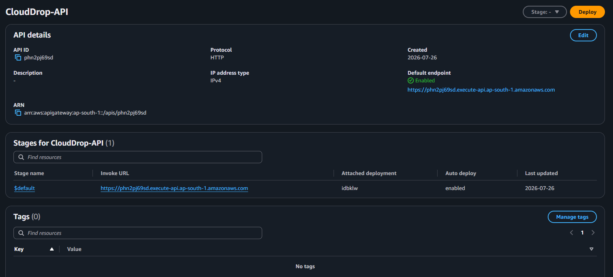
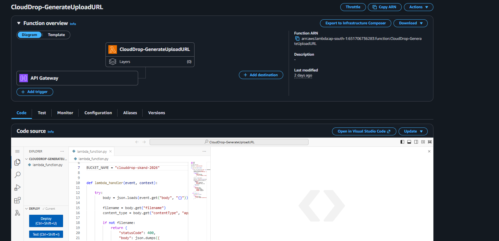
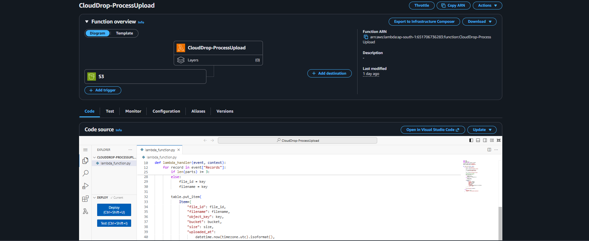
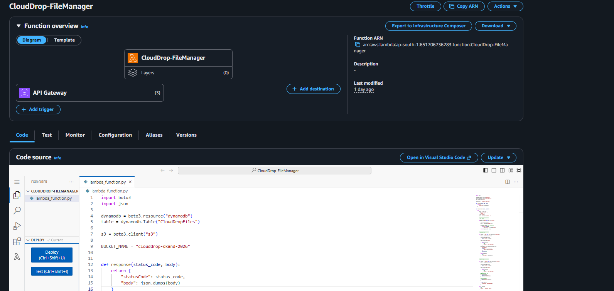

# CloudDrop

**Serverless File Storage and Management System built on Amazon Web Services (AWS)**


---

## Overview

**CloudDrop** is a serverless cloud file management platform that allows users to upload, index, retrieve, download, and delete files through a responsive web interface. 

Conventional file upload architectures channel multi-megabyte binary payloads directly through application servers, resulting in heavy memory pressure, bandwidth saturation, and scaling bottlenecks. CloudDrop solves this by leveraging an **asynchronous, event-driven serverless architecture**:

1. File uploads bypass backend servers entirely by uploading directly from the client to **Amazon S3** using cryptographically signed **pre-signed URLs**.
2. Upload completion triggers an event-driven **AWS Lambda** worker that automatically indexes file metadata into **Amazon DynamoDB**.
3. File listings, downloads, and deletions are serviced through dedicated serverless endpoints exposed via **Amazon API Gateway**.

---

## Architecture


### Request & Event Workflow

```text
[ Client Browser ]
       │
       │ 1. POST /generate-upload-url (filename, contentType)
       ▼
[ Amazon API Gateway ]
       │
       ▼
[ Lambda: GenerateUploadURL ] ─── 2. Calls S3 API ───► [ Amazon S3 ]
       │                                                    │
       ▼ 3. Returns presigned upload URL (300s TTL)         │
[ Client Browser ] ─────────────────────────────────────────┘
       │
       │ 4. Direct binary HTTP PUT using Presigned URL
       ▼
[ Amazon S3 (clouddrop-bucket) ]
       │
       │ 5. S3 ObjectCreated Event (async)
       ▼
[ Lambda: ProcessUpload ]
       │
       │ 6. Writes metadata (file_id, size, key, timestamp)
       ▼
[ Amazon DynamoDB (CloudDropFiles) ]
       ▲
       │ 7. Query / Delete / Read operations
       ▼
[ Lambda: FileManager ] ◄───► [ Amazon API Gateway ] ◄───► [ Client Browser ]
```

---

## AWS Services & Component Breakdown

| Service | Component | Role & Technical Responsibility |
| :--- | :--- | :--- |
| **Amazon S3** | Object Store | Stores raw file binaries organized under `uploads/{file_id}/{filename}` with automated lifecycle policies. |
| **AWS Lambda** | `GenerateUploadURL` | Validates client payloads, mints unique UUID identifiers, and requests ephemeral S3 pre-signed PUT URLs. |
| **AWS Lambda** | `ProcessUpload` | Consumes S3 `s3:ObjectCreated:*` events, URL-decodes object keys, and persists file records into DynamoDB. |
| **AWS Lambda** | `FileManager` | Dispatches `/files` (list), `/download/{file_id}` (presigned GET), and `/files/{file_id}` (atomic S3 + DynamoDB deletion). |
| **Amazon DynamoDB** | `CloudDropFiles` | NoSQL key-value store maintaining indexed metadata: `file_id` (PK), `filename`, `object_key`, `size`, `uploaded_at`, and `status`. |
| **Amazon API Gateway** | HTTP / REST API | Managed reverse proxy handling CORS, routing, and HTTP method dispatch to backend Lambda handlers. |
| **AWS IAM** | Execution Roles | Enforces the principle of least privilege with granular access policies for S3, DynamoDB, and CloudWatch Logs. |

---

## Key Features

- **Direct-to-S3 Presigned Uploads:** File binaries stream directly from the browser to Amazon S3, eliminating server memory overhead.
- **Event-Driven Metadata Indexing:** S3 upload completion triggers asynchronous Lambda processing without requiring synchronous client polling.
- **Atomic Deletions:** Deleting a file purges both the Amazon S3 object and the corresponding Amazon DynamoDB metadata item.
- **Secure Ephemeral Access:** Upload URLs expire within 300 seconds; download links are generated dynamically on demand.
- **Zero Idle Compute Cost:** Fully serverless architecture scaling automatically from zero to peak traffic without provisioned servers.

---

## Repository Structure

```text
CloudDrop/
├── docs/
│   ├── architecture.png            # High-level system architecture diagram
│   └── screenshots/                # AWS Console deployment & verification captures
│       ├── application-ui.png      # Frontend web dashboard
│       ├── API.png                 # API Gateway console overview
│       ├── Routes'.png             # API Gateway route definitions
│       ├── Lambda Overview.png     # AWS Lambda function catalog
│       ├── GenerateUploadURL.png   # Presigned URL generation function
│       ├── Processupload.png       # S3 event listener function
│       ├── FileManager.png         # File management function
│       ├── S3 - buckets.png        # Amazon S3 bucket structure
│       ├── Dynamo DB.png           # DynamoDB table schema
│       └── Screenshot 2026-07-26 222913.png
├── frontend/
│   ├── index.html                  # Responsive file management UI
│   ├── script.js                   # Client-side API integration & upload handler
│   └── styles.css                  # Clean, modern UI styling
├── lambda/
│   ├── GenerateUploadURL.py        # Mints presigned PUT URLs
│   ├── ProcessUpload.py            # Event listener persisting metadata to DynamoDB
│   └── FileManager.py              # GET/DELETE API routing and management
├── .gitignore
├── LICENSE
└── README.md
```

---

## REST API Specification

### 1. Request Upload URL
- **Endpoint:** `POST /generate-upload-url`
- **Payload:**
  ```json
  {
    "filename": "document.pdf",
    "contentType": "application/pdf"
  }
  ```
- **Response (`200 OK`):**
  ```json
  {
    "fileId": "6f2e8b91-12c4-4a8f-9e73-b4d21e89f104",
    "uploadUrl": "https://clouddrop-bucket.s3.amazonaws.com/uploads/6f2e8b91-12c4-4a8f-9e73-b4d21e89f104/document.pdf?AWSAccessKeyId=...",
    "objectKey": "uploads/6f2e8b91-12c4-4a8f-9e73-b4d21e89f104/document.pdf"
  }
  ```

### 2. List Files
- **Endpoint:** `GET /files`
- **Response (`200 OK`):**
  ```json
  [
    {
      "file_id": "6f2e8b91-12c4-4a8f-9e73-b4d21e89f104",
      "filename": "document.pdf",
      "size": 1048576,
      "uploaded_at": "2026-07-26T14:30:00.000Z",
      "status": "UPLOADED"
    }
  ]
  ```

### 3. Download File
- **Endpoint:** `GET /download/{file_id}`
- **Response (`200 OK`):**
  ```json
  {
    "downloadUrl": "https://clouddrop-bucket.s3.amazonaws.com/uploads/.../document.pdf?AWSAccessKeyId=..."
  }
  ```

### 4. Delete File
- **Endpoint:** `DELETE /files/{file_id}`
- **Response (`200 OK`):**
  ```json
  {
    "message": "File deleted successfully"
  }
  ```

---

## AWS Deployment & Setup

### Prerequisites
- An active **AWS Account** with administrative permissions.
- AWS CLI configured locally (`aws configure`) or access to the AWS Management Console.

### 1. Amazon S3 Configuration
1. Create a general-purpose S3 bucket (e.g., `clouddrop-skand-storage`).
2. Configure **CORS** on the S3 bucket to allow client-side PUT requests:
   ```json
   [
     {
       "AllowedHeaders": ["*"],
       "AllowedMethods": ["PUT", "GET", "HEAD"],
       "AllowedOrigins": ["*"],
       "ExposeHeaders": ["ETag"]
     }
   ]
   ```

### 2. Amazon DynamoDB Configuration
1. Create a DynamoDB table named `CloudDropFiles`.
2. Set the **Partition Key** to `file_id` (Type: `String`).

### 3. Deploy Lambda Functions
1. **`GenerateUploadURL`**:
   - Runtime: `Python 3.11` or `3.12`.
   - Environment Variable: `BUCKET_NAME = <your-bucket-name>`.
   - IAM Permission: `s3:PutObject` on target bucket.
2. **`ProcessUpload`**:
   - Runtime: `Python 3.11` or `3.12`.
   - Trigger: Add S3 Event Notification for `s3:ObjectCreated:*` with prefix `uploads/`.
   - IAM Permission: `dynamodb:PutItem` on `CloudDropFiles`.
3. **`FileManager`**:
   - Runtime: `Python 3.11` or `3.12`.
   - Environment Variable: `BUCKET_NAME = <your-bucket-name>`.
   - IAM Permissions: `dynamodb:Scan`, `dynamodb:GetItem`, `dynamodb:DeleteItem`, `s3:GetObject`, `s3:DeleteObject`.

### 4. Amazon API Gateway Setup
1. Create an **HTTP API** (or REST API).
2. Create routes:
   - `POST /generate-upload-url` -> integrates with `GenerateUploadURL`
   - `GET /files` -> integrates with `FileManager`
   - `GET /download/{file_id}` -> integrates with `FileManager`
   - `DELETE /files/{file_id}` -> integrates with `FileManager`
3. Enable **CORS** in API Gateway settings allowing your frontend origin, methods (`GET`, `POST`, `DELETE`, `OPTIONS`), and headers (`Content-Type`).

### 5. Frontend Client Configuration
1. Open `frontend/script.js`.
2. Update the `API_BASE_URL` constant with your deployed API Gateway invoke URL:
   ```javascript
   const API_BASE_URL = "https://<api-id>.execute-api.<region>.amazonaws.com";
   ```
3. Open `frontend/index.html` in any web browser or serve via AWS S3 / CloudFront.

---

## AWS Console Verification & Screenshots

| Component | AWS Console Verification |
| :--- | :--- |
| **Web Interface** |  |
| **API Gateway Overview** |  |
| **API Route Map** |  |
| **Lambda Catalog** |  |
| **GenerateUploadURL Handler** |  |
| **ProcessUpload Handler** |  |
| **FileManager Handler** |  |
| **S3 Storage Tier** |  |
| **DynamoDB Table Tier** |  |

---

## Future Improvements

- [ ] Integrate **Amazon Cognito** for user authentication and user-scoped file segregation.
- [ ] Implement **Amazon CloudFront** CDN distribution for accelerated global asset delivery.
- [ ] Add client-side chunked multipart uploads for files exceeding 100 MB.
- [ ] Automated Infrastructure as Code (IaC) deployment using **AWS SAM** or **Terraform**.

---

## License

This project is licensed under the [MIT License](LICENSE).
