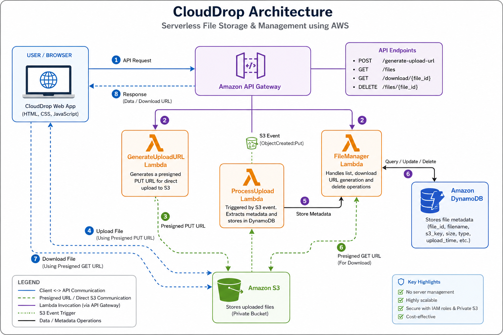
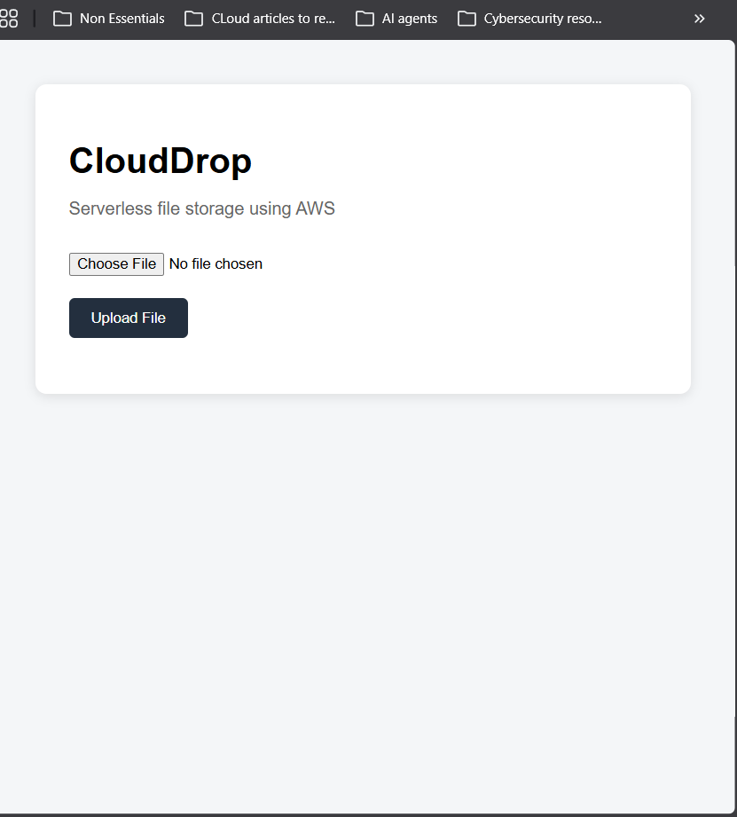

# ☁️ CloudDrop

> A serverless file storage and management system built on AWS using Lambda, API Gateway, Amazon S3, and DynamoDB.


---

## 📖 Overview

CloudDrop is a serverless file storage application that enables users to upload, store, retrieve, download, and delete files through a simple web interface.

Instead of maintaining traditional servers, CloudDrop leverages AWS managed services to provide a scalable and cost-effective architecture.

The application uses pre-signed Amazon S3 URLs for secure uploads while maintaining file metadata in Amazon DynamoDB.

---

# ✨ Features

- Secure file uploads using pre-signed S3 URLs
- Serverless backend powered by AWS Lambda
- File metadata stored in DynamoDB
- Download files through API Gateway
- Delete uploaded files
- Responsive web interface
- Fully serverless architecture
- Event-driven processing

---

# 🏗 Architecture



---

# 🔄 Workflow

1. User selects a file from the web interface.
2. Frontend requests a pre-signed upload URL.
3. API Gateway invokes the GenerateUploadURL Lambda.
4. Lambda creates a secure pre-signed S3 URL.
5. Browser uploads the file directly to Amazon S3.
6. S3 triggers the ProcessUpload Lambda.
7. File metadata is stored in DynamoDB.
8. Users can list, download, or delete files through the FileManager Lambda.

---

# ☁ AWS Services Used

| Service | Purpose |
|----------|---------|
| Amazon S3 | File storage |
| AWS Lambda | Backend business logic |
| Amazon API Gateway | REST API endpoints |
| Amazon DynamoDB | File metadata storage |
| AWS IAM | Permissions and security |
| Amazon CloudWatch | Logging and monitoring |

---

# 🛠 Technology Stack

### Frontend

- HTML5
- CSS3
- JavaScript

### Backend

- Python
- AWS Lambda
- API Gateway

### Database

- Amazon DynamoDB

### Storage

- Amazon S3

---

# 📂 Project Structure

```text
CloudDrop
│
├── docs
│   ├── architecture.png
│   └── screenshots
│
├── frontend
│   ├── index.html
│   ├── script.js
│   └── styles.css
│
├── lambda
│   ├── GenerateUploadURL.py
│   ├── ProcessUpload.py
│   └── FileManager.py
│
├── README.md
├── LICENSE
└── .gitignore
```

---

# 📸 Screenshots

## Web Interface



---

## API Gateway


---

## API Routes


---

## Lambda Functions


---

### GenerateUploadURL


---

### ProcessUpload


---

### FileManager


---

## Amazon S3


---

## DynamoDB Table


---

## Stored Metadata


---

# 🚀 API Endpoints

| Method | Endpoint | Description |
|---------|----------|-------------|
| POST | `/generate-upload-url` | Generate a pre-signed upload URL |
| GET | `/files` | Retrieve all uploaded files |
| GET | `/download/{file_id}` | Download a file |
| DELETE | `/files/{file_id}` | Delete a file |

---

# ⚙ Setup

Clone the repository

```bash
git clone https://github.com/Skand203/CloudDrop.git
```

Open the frontend:

```text
frontend/index.html
```

Configure your own AWS resources:

- Amazon S3 Bucket
- API Gateway
- Lambda Functions
- DynamoDB Table
- IAM Roles

Update the API endpoint inside:

```text
frontend/script.js
```

Deploy the Lambda functions and you're ready to use CloudDrop.

---

# 🔮 Future Improvements

- User authentication
- Drag-and-drop uploads
- Folder support
- Search functionality
- File sharing with temporary links
- Progress indicators
- Version history
- User dashboards
- CloudFront CDN integration

---

# 📚 Learning Outcomes

This project demonstrates practical experience with:

- Serverless Computing
- REST API Development
- Event-Driven Architecture
- Cloud Storage
- NoSQL Databases
- IAM Permissions
- AWS Integration
- Frontend and Backend Integration

---

# 📄 License

This project is licensed under the MIT License.

---

# 👨‍💻 Author

**Skand Shukla**

GitHub: https://github.com/Skand203

---

⭐ If you found this project interesting, consider giving it a star.